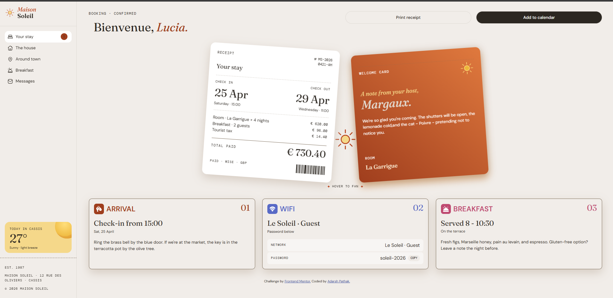

# Frontend Mentor - Hotel Booking Confirmation Page

A responsive hotel booking confirmation page built as a solution to the [Hotel Booking Confirmation Page challenge](https://www.frontendmentor.io/challenges/hotel-booking-confirmation-page) on Frontend Mentor.

## Overview

### The Challenge

The goal was to build a hotel booking confirmation page featuring a branded sidebar, booking details, a welcome card, and additional information cards.

The interface should:

- Adapt to different screen sizes.
- Provide hover and focus states for interactive elements.
- Allow users to open and close the navigation menu on smaller screens.
- Present booking and guest information in a clear, visually appealing layout.

### Screenshot

### Links

- **GitHub Repository:** [View Repository](https://github.com/MrAdarshPathak-dev/)frontend-mentor-hotel-booking-confirmation-page
- **Live Site:** [View Live Site](https://mradarshpathak-dev.github.io/frontend-mentor-hotel-booking-confirmation-page/)

## My Process

### Built With

- Semantic HTML5
- CSS3
- CSS Flexbox
- CSS Grid
- CSS media queries for responsive layouts
- Custom fonts and typography
- CSS transitions and hover effects

### What I Learned

This project helped me improve my understanding of typography, responsive layouts, accessibility, and CSS spacing.

**1. Working with Multiple Font Families**

One of my biggest challenges was managing different font families within the same card. The design used serif, sans-serif, and monospace typography for different types of content. I learned how font families, font sizes, weights, and spacing work together to create a clear visual hierarchy.

**2. Writing Meaningful Image Alt Text**

I learned that decorative images and icons that do not add information beyond nearby text can often use an empty `alt` attribute (`alt=""`). This helps prevent screen readers from announcing unnecessary information. Images that convey meaningful information should have appropriate alternative text.

**3. Managing Mobile Navigation**

I worked on the mobile navigation behavior and encountered an issue where the page could scroll while the menu was open. This helped me understand the importance of managing overlays, scrolling behavior, and usability on smaller screens.

**4. Understanding CSS Logical Properties**

I explored `margin-inline` and learned how logical properties control spacing along the inline axis. They also make layouts easier to adapt to different writing directions compared with relying only on physical properties such as `margin-left` and `margin-right`.

### Challenges

The most challenging part of this project was matching the typography and spacing to the intended design. Using multiple font families within a single card required careful adjustments to maintain visual consistency.

Another challenge was handling the mobile navigation and preventing unwanted page scrolling while the menu was open. I worked through these issues by experimenting with CSS properties, testing different viewport sizes, and refining the layout.

### Continued Development

In future projects, I want to focus on:

- Improving responsive typography and font pairing.
- Building more accessible navigation and interactive components.
- Understanding mobile menu behavior and scroll locking.
- Using CSS logical properties more confidently.
- Writing cleaner, more maintainable CSS.

### AI Collaboration

I used AI as a learning and debugging assistant to understand CSS concepts, explore properties, and investigate possible solutions when I encountered difficulties. I implemented and refined the project through my own development and testing process.

## Author

- **GitHub:** [@MrAdarshPathak-dev](https://github.com/MrAdarshPathak-dev)
- **Frontend Mentor:** [@MrAdarshPathak-dev](https://www.frontendmentor.io/profile/MrAdarshPathak-dev)

## Acknowledgments

Thanks to [Frontend Mentor](https://www.frontendmentor.io/) for providing the challenge and design resources that helped me practice my frontend development skills.
